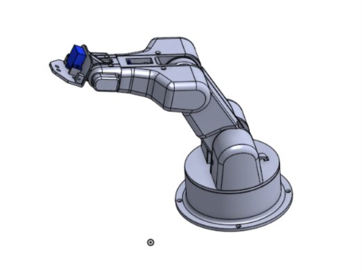

# SolidWorks Robotic Arm | CAD & Mechanical Design Project

**3D Modeling and Assembly of a 5-DOF Robotic Arm**  
University coursework · SolidWorks · Robotics  
**Author:** Mihai-Cezar Moldovan

## Overview

A university CAD project focused on **3D part modeling**, **mechanical assembly**, and the organization of a multi-component robotic arm in **SolidWorks**. The completed digital model includes the base, waist, articulated arm links, protective covers, and a mechanical gripper.

The project was developed **following the university-provided *SolidWorks Student's Project Guide (2023)***. The original component geometry and guided workflow originate from that teaching resource; my coursework involved creating the corresponding CAD models and assemblies. This repository showcases my SolidWorks modeling and assembly work, not an independently invented robot design or a physically built prototype.



## Key skills demonstrated

- **Parametric part modeling:** Sketches, dimensions, constraints, extrusions, cuts, revolves, fillets, and patterned features.
- **Mechanical assembly:** Positioning individual components within robotic arm assemblies using SolidWorks assembly tools.
- **Component integration:** Mechanical parts and mounting interfaces for servo motors and the end-effector.
- **Assembly organization:** Maintaining native SolidWorks part and assembly files, together with exchange-format parts.
- **Manufacturing awareness:** Interpreting CAD geometry intended for additive manufacturing and technical drawings as described in the project guide.

## CAD model

The modeled system is based on a **5-DOF robotic arm** presented in the course guide. The design includes major mechanical groups such as the base, waist, successive arm sections, covers, and gripper.

The guide describes mounting provisions for **MG996R** and **Micro 9g** servo motors. The uploaded CAD archive includes model files representing these motors.

## Project files

| File / folder | Description |
| --- | --- |
| [`cad/Robot.SLDASM`](cad/Robot.SLDASM) | Main SolidWorks assembly |
| [`cad/`](cad/) | Individual `.SLDPRT` parts, other `.SLDASM` assemblies, and STEP components |
| [`images/solidworks-robotic-arm.png`](images/solidworks-robotic-arm.png) | Screenshot of the robotic arm CAD model |

## Repository structure

```text
solidworks-robotic-arm/
├── README.md
├── images/
│   └── solidworks-robotic-arm.png
└── cad/
    ├── Robot.SLDASM
    ├── Assem1.SLDASM, Assem2.SLDASM, ...
    ├── Part1-base of the robotic arm.SLDPRT, ...
    ├── Servo Motor MG996R.SLDPRT
    ├── Servo Motor Micro 9g.SLDPRT
    └── additional .SLDPRT and .STEP components
```

## How to view

1. Download the repository or select **Code → Download ZIP** on GitHub.
2. Extract all files while keeping the contents of `cad/` together.
3. Open `cad/Robot.SLDASM` in a compatible installation of SolidWorks.
4. If prompted to locate referenced components, point SolidWorks to the `cad/` folder. Some components may need to be resolved manually depending on the original assembly references.

**Note:** Native SolidWorks CAD files are not displayed as interactive 3D models in GitHub's standard file viewer. The screenshot above provides a quick visual preview. The assembly has not been verified to resolve all external references on a clean SolidWorks installation.

## Academic context and attribution

This student project follows **Zsolt Levente Buna, Radu Comes, and Raul Silviu Rozsos**, *SolidWorks Student's Project Guide* (U.T. PRESS, Cluj-Napoca, 2023; ISBN 978-606-737-450-6). The guide's instructions and reference design were provided for university coursework.

The copyrighted guide PDF is **not included** in this public repository.
